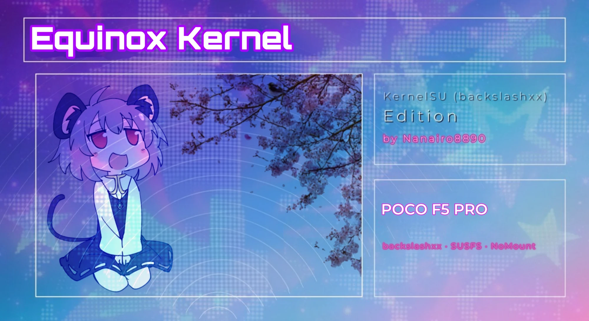

# Equinox backslashxx Edition by Nanairo8890

**POCO F5 Pro / Redmi K60** · `mondrian` · Snapdragon 8+ Gen 1 · **MistOS 5.1 Beta**

**Developer:** [LF52406](https://github.com/LF52406) · **[Download builds](../../releases)**

---

> [!NOTE]
> **This repository is the backslashxx edition of Equinox**, made by **Nanairo** with
> LF52406's permission. It is Equinox 5.10.269 as released, with these changes:
>
> - **[backslashxx/KernelSU](https://github.com/backslashxx/KernelSU)** v3.3.1+52 (UAPI 6, a fork of [KernelSU](https://github.com/tiann/KernelSU)) instead of FinaSU, as the `KernelSU/` submodule, built into the kernel with backslashxx's own hook backend (syscall table hooking, `KSU_TAMPER_SYSCALL_TABLE`, which backslashxx documents as Clang CFI compliant; not an inline fs/exec.c hook). Use **backslashxx's official manager** (package `me.weishu.kernelsu`).
> - **SUSFS v2.4.0** from [simonpunk's](https://gitlab.com/simonpunk/susfs4ksu) `gki-android12-5.10` branch. backslashxx ships no SUSFS support of its own, so this edition adds a dedicated interface (`KernelSU/kernel/extension/susfs.c`) wiring SUSFS's SID lookups, zygote/zygote_next umount handling and SELinux rule registration onto backslashxx's own code.
> - **BBR** as the default TCP congestion control.
> - **[NoMount](https://github.com/maxsteeel/nomount) v2.3.1** by maxsteeel built in (`fs/nomount`), which includes deref3046's fix. Processes whose modules are umounted see the stock filesystem, and NoMount is hidden from `/sys/module` and `/proc/kallsyms`. SUSFS and NoMount are each controlled from their own root module (`ksu_module_susfs`, the NoMount metamodule), installable from backslashxx's manager like any KernelSU module — no special manager is needed.
> - **Extra `/proc/kallsyms` hiding**: backslashxx exports many driver symbols whose names do not start with the usual KernelSU/SUSFS prefixes, so SUSFS's filter left them visible. The filter now also hides those, each one checked against a clean Equinox build.
>
> Everything else, DroidSpaces included, is LF52406's work, described below. The official Equinox
> builds are at [LF52406/Equinox-Kernel-sm8450](https://github.com/LF52406/Equinox-Kernel-sm8450).
> Report problems with this edition to Nanairo8890, not to LF52406 or backslashxx.
>
> Build: `CLANG_DIR=/path/to/clang/bin scripts/equinox/build-bsxx.sh`, then `scripts/equinox/package-bsxx.sh` · Changes: [release notes](scripts/equinox/release-notes/5.10.269-bsxx-1.0.md) · Changelog: [English](CHANGELOG.en.txt) · [Español](CHANGELOG.es.txt) · [Português (Brasil)](CHANGELOG.pt-BR.txt) · [Русский](CHANGELOG.ru.txt)

---

## Current Build

| Component | Current |
|:--|:--|
| **Version** | `1.0` |
| **Linux** | `5.10.269-Nanairo-backslashxx` |
| **Compatibility** | MistOS and the AOSP ROMs listed in [Other AOSP ROMs](#other-aosp-roms); tested on MistOS 20261025 (`fastboot boot`) |
| **backslashxx/KernelSU** | `v3.3.1+52`, built in · syscall table hooks |
| **SUSFS** | `2.4.0` |
| **NoMount** | `v2.3.1` built in |
| **DroidSpaces** | Supported |
| **TCP** | BBR default · CUBIC available |
| **Toolchain** | AOSP Clang `22.0.0` (r584948) |
| **Build** | ThinLTO · Clang CFI · MODVERSIONS |
| **KMI** | Verified against clean Equinox 5.10.269 |

---

## Features

| Group | Included |
|:--|:--|
| **Root & hiding** | backslashxx/KernelSU integration · SUSFS · extra `/proc/kallsyms` hiding |
| **Containers** | DroidSpaces · PID namespaces · IPC / SYSVIPC |
| **Networking** | TCP BBR · runtime congestion-control switching |
| **Device** | mondrian production config · Goodix touch stability fixes |
| **Packaging** | Verified AnyKernel3 release package · vendor module check before flashing |

---

## Latest Changes

### 1.0

- First release of this edition
- backslashxx/KernelSU `v3.3.1+52` (UAPI 6) built in as the `KernelSU/` submodule, instead of FinaSU; uses its own hook backend (syscall table, `KSU_TAMPER_SYSCALL_TABLE`, Clang CFI compliant), not an inline fs/exec.c hook
- backslashxx ships no SUSFS support of its own: a new interface was written for this edition (`KernelSU/kernel/extension/susfs.c`) with the SID lookups, the zygote/zygote_next umount handling and the SELinux rule registration
- Same NoMount v2.3.1, SUSFS v2.4.0, BBR, DroidSpaces, installer and ROM compatibility as the other editions
- Tested on the phone with `fastboot boot`: root, SELinux Enforcing, NoMount 23 (785), SUSFS v2.4.0 and the backslashxx manager work, and `/proc/kallsyms` shows no root-revealing names
- `/proc/kallsyms` filter reworked for backslashxx's own symbols, checked against a clean Equinox build: 0 symbols that give away root
- KMI verified against clean Equinox 5.10.269: 0 changed CRCs, 0 removed symbols
- Vendor module CRCs checked against MistOS 20261025 and the latest Keosh builds (337 `vendor_boot` + 390 `vendor_dlkm`)

[View full release notes](../../releases)

---

## Downloads & Flashing

Builds are published through **GitHub Releases**, with the SHA256 of each file on the release page.

**Current package:** `Equinox-5.10.269-backslashxx-1.0-mondrian.zip`

Download the release asset and flash the AnyKernel3 ZIP using a compatible recovery or kernel flasher. The ZIP only replaces the kernel `Image`, after checking that the ROM's vendor modules accept it; if you update the ROM, flash it again afterwards. Install backslashxx's manager to manage root and modules, and the `ksu_module_susfs` and NoMount modules from it to control SUSFS and NoMount.

Not sure whether your ROM is compatible? Flash `Equinox-5.10.269-backslashxx-1.0-mondrian-checkonly.zip` first: it runs the same check and flashes nothing.

> GitHub-generated `Source code` archives are not flashable kernel packages.

---

## Other AOSP ROMs

The ZIP keeps the ROM's vendor modules (`vendor_boot` and `vendor_dlkm`), and those only load on a kernel with the same symbol CRCs (KMI) as the kernel they were built with. A single `Image` therefore works on the ROMs whose kernel comes from the same source as Equinox, not on every ROM:

| ROM | ROM kernel | Status |
|:--|:--|:--|
| MistOS 5.1 Beta (20261011 to 20261025) | 5.10.269 | Tested on 20261025 (`fastboot boot`); the CRCs of all 337 `vendor_boot` and 390 `vendor_dlkm` modules match |
| MistOS 5.0 Alpha 20260914 | `5.10.256-gki-gb48a614d5811` | Compatible: the CRCs of all 337 `vendor_boot` and 390 `vendor_dlkm` modules match |
| Latest builds from Keosh: crDroid 12.12 (20260928), Evolution X 11.11, Infinity-X 3.12 (VANILLA, GAPPS core and extra, 29.09.2026), Lunaris 3.12 (VANILLA and GMS), LineageOS 23.2 (20260929), Axion 2.8 (VANILLA and GMS) | `5.10.269-gki-g1598dc02ea84` | Compatible: the CRCs of all 337 `vendor_boot` and 390 `vendor_dlkm` modules match (checked with r2 and with 2.0) |
| Infinity-X 4.1 by LF5 (17.10.2026) | `5.10.269-gki-g283772ceb844` | Compatible: the CRCs of all 337 `vendor_boot` and 390 `vendor_dlkm` modules match (checked with r2 and with 2.0) |
| crDroid 12.12 by Taha Keles (20260930) | `5.10.260-Weil+` | Compatible: all 725 non-blocklisted modules match the r2 kernel (`kmicheck`), which exports the same CRCs as 2.0 |
| AOSPA calcite (a17-gms 20261012, a17-microg 20261013), PenguinOS celerity (20261011) | `5.10.269-beryl-7156c6f9fb`, their own | **Not compatible**: 376 + 279 `vendor_boot` / `vendor_dlkm` modules, almost all with other CRCs |
| LineageOS `lineage-24.0` (Android 17) and `lineage-23.2` (Android 16 QPR2), and ROMs built on them | 5.10.269 | Expected to work: same tree as Equinox |
| LineageOS `lineage-23.0` / `lineage-23.1` (Android 16) | 5.10.247 | Not verified |
| LineageOS `lineage-22.2` (Android 15) | 5.10.245 | Not verified |
| HyperOS / MIUI | | Not supported |

Packages made with `scripts/equinox/package-bsxx.sh` check this before flashing: `kmicheck` reads the ROM's modules from `vendor_boot` and `vendor_dlkm` and compares them with the kernel's own symbol table (`kmi.symvers`). If any module would be rejected (different CRC, a symbol this kernel does not export, a duplicate export or a different vermagic), the installer stops before writing anything and lists the modules. A ZIP with `nocheck` in its file name skips the check; one with `checkonly` runs the check and flashes nothing, to find out whether a ROM is compatible. Released packages from 1.8 on include this check (1.5 was not released separately); r2 does not.

---

## Reporting Issues

When reporting a problem to Nanairo8890, include the kernel version, a short reproduction description and relevant logs such as `dmesg`, `logcat`, `pstore / ramoops`, or watchdog / panic logs when available.

---

## Support Development

If you find **Equinox Kernel** useful and would like to support its continued development, donations are always appreciated but entirely optional.

---

## Support Nanairo

If this backslashxx edition is useful to you and you would like to support Nanairo8890's work on it (the backslashxx/KernelSU, SUSFS and NoMount integration, and the vendor module check), donations are welcome but entirely optional.

---

## Credits & Upstreams

- [**LF52406**](https://github.com/LF52406) — Equinox Kernel, the base of this edition
- [**LineageOS/android_kernel_xiaomi_sm8450**](https://github.com/LineageOS/android_kernel_xiaomi_sm8450) — primary kernel base used by Equinox
- [**LineageOS/android_kernel_qcom_sm8450**](https://github.com/LineageOS/android_kernel_qcom_sm8450) — Qualcomm common-kernel upstream used by Equinox
- [**Android Common Kernel**](https://android.googlesource.com/kernel/common) / [**Linux Kernel**](https://www.kernel.org/) — Android kernel infrastructure and upstream Linux
- [**backslashxx/KernelSU**](https://github.com/backslashxx/KernelSU) by **backslashxx**, a fork of [**KernelSU**](https://github.com/tiann/KernelSU) by **tiann** — kernel root implementation of this edition
- [**SUSFS**](https://gitlab.com/simonpunk/susfs4ksu) by **simonpunk** — SUSFS integration for Linux 5.10
- [**DroidSpaces**](https://github.com/ravindu644/Droidspaces-OSS) by **ravindu644** — container runtime and kernel requirements
- [**NoMount**](https://github.com/maxsteeel/nomount) by **maxsteeel**, with a fix by **deref3046** — VFS path redirection, built in
- [**AnyKernel3**](https://github.com/osm0sis/AnyKernel3) by **osm0sis** — flashable kernel packaging
- [**Nanairo8890**](https://github.com/nanairo8890) — backslashxx/KernelSU, SUSFS, BBR and NoMount integration of this edition

Thanks to Qualcomm, LineageOS contributors, Android Common Kernel contributors, and the broader Linux kernel community for the upstream kernel, platform, and driver work that Equinox builds upon.
